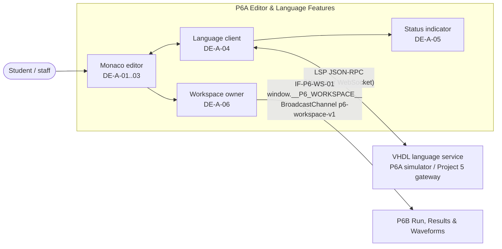
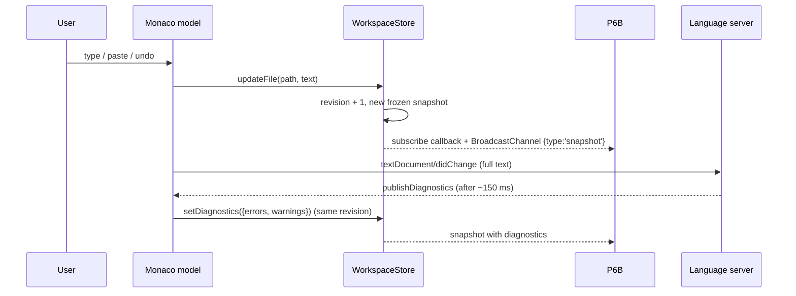
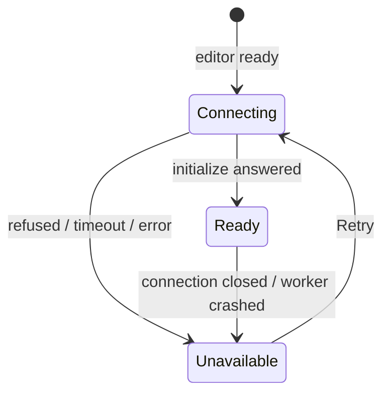

# P6A Editor & Language Features: Software Design (component view)

| Field | Value |
|---|---|
| Component | P6A Editor & Language Features |
| Parent | P6 Web VHDL Laboratory (SDD v1.0) |
| Paired component | P6B Run, Results & Waveforms (not designed here) |
| Interfaces | IF-P6-WS-01 shared workspace (writer); LSP to a VHDL language service (client) |

This document describes the P6A design elements that the System Integration Test Specification refers to (DE-A-xx). Requirement IDs follow the combined SRS v1.0.

## 1. Context

## 2. Design elements

| DE | Module | Responsibility | Requirements |
|---|---|---|---|
| DE-A-01 | `src/files/referenceFiles.ts` | Fixed file model: `src/counter.vhd` (design), `tb/tb_counter.vhd` (testbench), top `tb_counter`. Same paths as IF-P6-WS-01 and P6B fixtures (closes R-02) | P6A-FR-1, P6A-DC-03 |
| DE-A-02 | `src/editor/monacoSetup.ts`, `vhdlLanguage.ts` | Starts Monaco via `MonacoVscodeApiWrapper` (classic mode); registers VHDL (Monarch highlighting, brackets, comments, indentation); one text model per file under `file:///workspace/` | P6A-FR-2, P6A-UR-1, P6A-DC-01 |
| DE-A-03 | `src/editor/VhdlEditor.tsx`, `src/components/*`, `App.tsx` | VS Code-like workbench: explorer, tabs, editor, PROBLEMS / APPROVED SCENARIO / OUTPUT panel, status bar, scenario menu | P6A-FR-3, P6A-UR-1, P6A-UR-2, P6A-DC-04 |
| DE-A-04 | `src/lsp/languageClient.ts` | `MonacoLanguageClient` over a Web Worker (`BrowserMessageReader/Writer`) or WebSocket (`vscode-ws-jsonrpc`); start-up timeout; teardown and restart | P6A-FR-4, P6A-FR-5, P6A-DC-02 |
| DE-A-05 | `src/lsp/status.ts`, `StatusBar`, banner | States `off / connecting / ready / unavailable` with a reason and Retry; the editor never waits on the service | P6A-FR-7 |
| DE-A-06 | `src/workspace/workspaceStore.ts` | Owner and only writer of IF-P6-WS-01. Immutable snapshots, `revision + 1` per edit, diagnostic counts with the same revision, both transports, answers `request-snapshot` | P6A-FR-6, P6A-IR-1, P6-StR4.1 |
| DE-A-07 | `src/languageService/*`, `simulator/server.ts` | **Language-service simulator** (test double for the Project 5 VHDL-LS gateway): lexer, analyzer, completion/hover, approved scenarios, LSP server; runs in a Worker or in Node over WebSocket; fault injection | P6-StR1.2, P6-StR3.1, P6A-FR-4, P6A-FR-5, P6A-PR-1 |

## 3. Key behaviour

### 3.1 Edit → publish (DE-A-03 → DE-A-06)

Scenario loads and **Reset files** go the other way (store → model). They are applied as one undoable edit per file, so `Ctrl+Z` returns to the previous text.

### 3.2 Language-service life cycle (DE-A-04, DE-A-05)

While unavailable, the editor stays editable, edits keep being published to P6B, and diagnostics are cleared, so the PROBLEMS panel never shows stale results.

### 3.3 Language-service simulator (DE-A-07)

The simulator is deterministic and small. Checks: missing `;`, unbalanced `()`, block structure (`end if` / `end process` / closing names), undeclared assignment targets and sensitivity-list names, unknown `entity work.<x>`, unterminated literals, and an unused-signal warning. Messages use GHDL wording, so the editor and P6B's run report the same problem in the same words (for example `';' is expected here`). `tests/integration/p6bFixtures.test.ts` checks that the editor shows errors for exactly the P6B cases that fail at analysis.

## 4. Configuration

All settings are URL parameters (see README): `lsp`, `lspFault`, `lspTimeout`, `scenario`, `run`, `p6b`. There is no persistent storage, account or server-side state (out of scope).

## 5. Change control

The file model, IF-P6-WS-01 fields and the approved scenarios are baselined. A change to any of them needs a CR, then reruns of the tests in `docs/test-documentation-P6A.md` §4.
