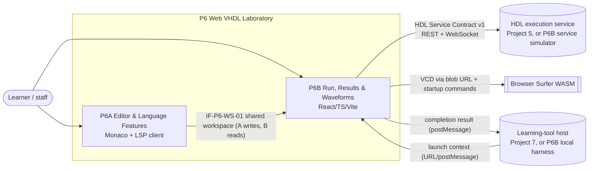
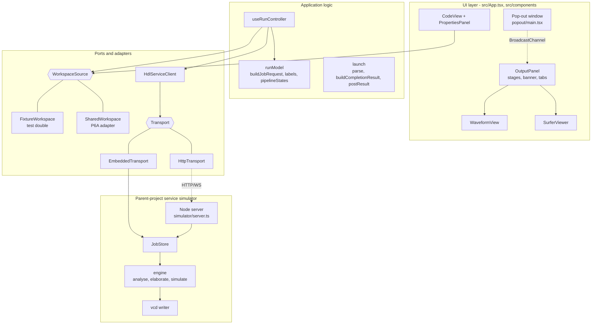
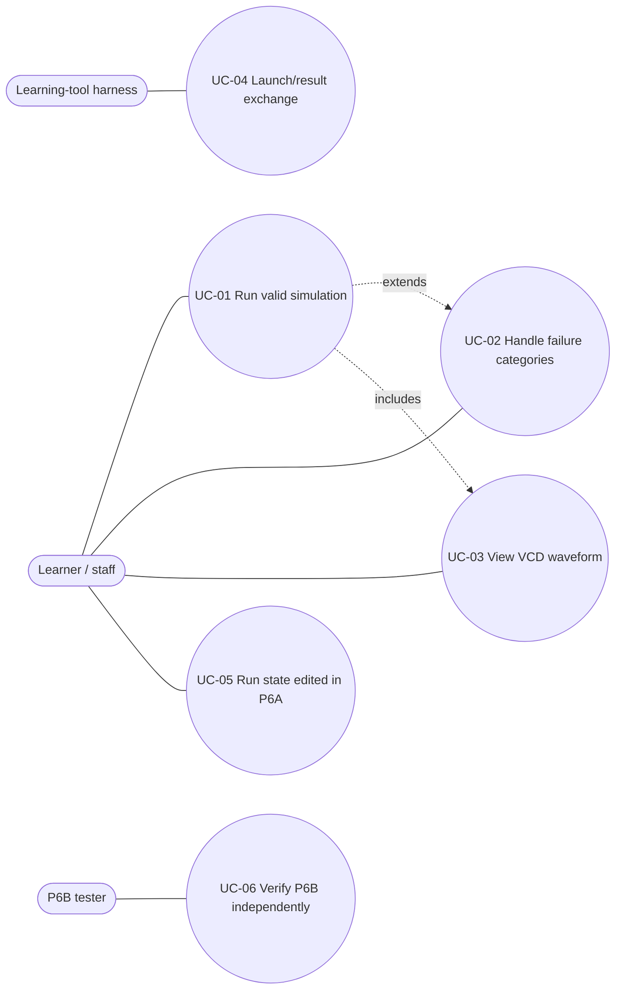
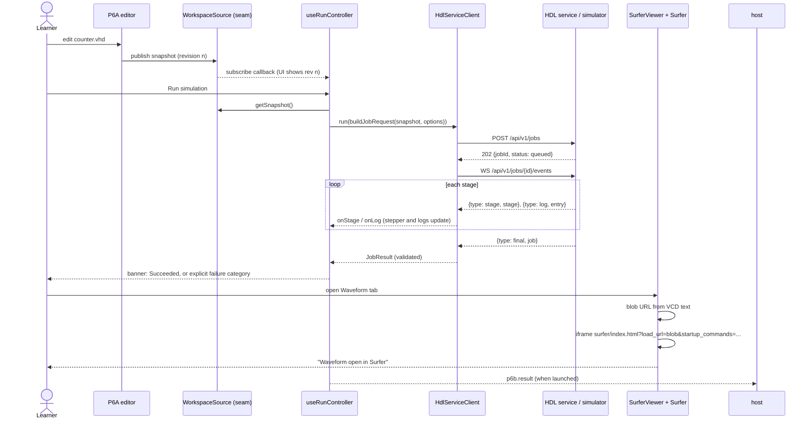
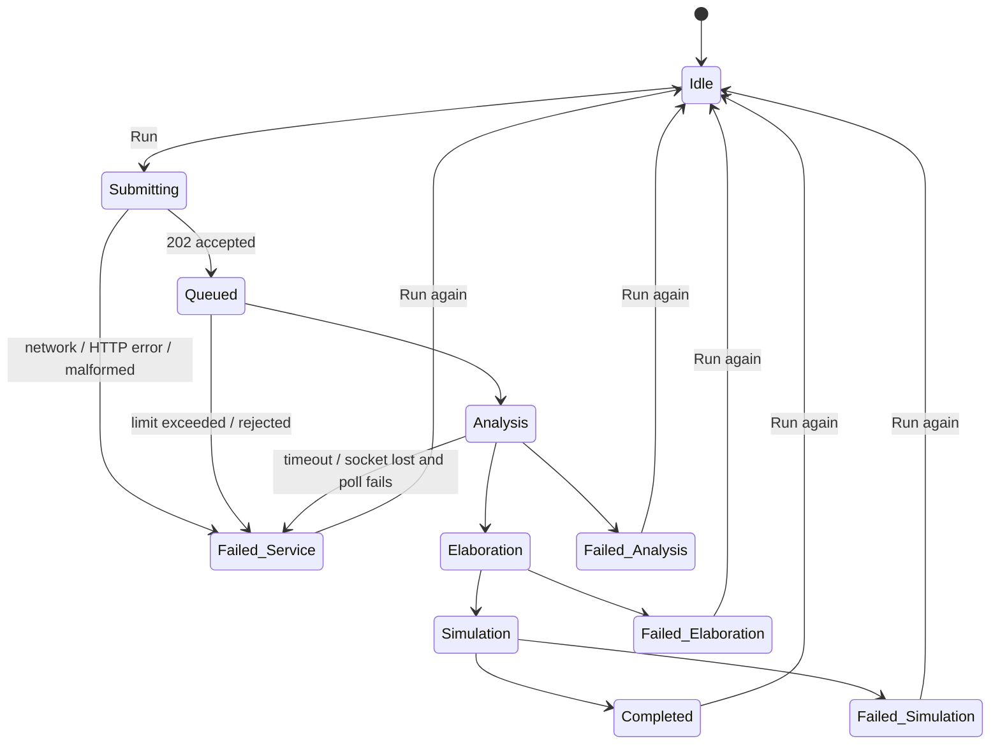
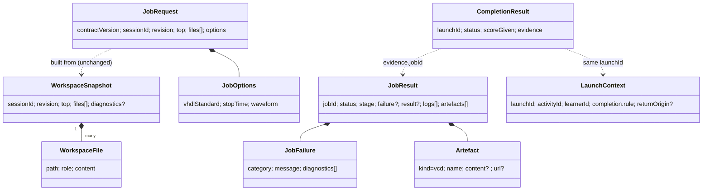

# Software Design Description: P6B Run, Results & Waveforms

ECNG 2007 Group 6, Subproject P6B · Version 1.1 · Informed by ISO/IEC/IEEE 42010:2022 and IEEE 1016-2009

| Item | Value |
|---|---|
| Component | P6B Run, Results & Waveforms (part of P6 Web VHDL Laboratory) |
| Requirements baseline | P6 SRS v1.0 (Draft), 25 Sep 2026, P6B sections |
| Stack | React 18, TypeScript 5, Vite 5, fetch + WebSocket client, browser Surfer (WASM) |
| Paired component | P6A Editor & Language Features (not designed here) |

## 1. Scope and design goals

P6B takes the workspace state published by P6A, submits it as an HDL job, shows every GHDL stage and its logs, names failures by category, and opens the returned VCD in Surfer. It also returns a completion result to a learning-tool host.

The design follows three goals:

1. **Independent testability.** Every external dependency sits behind one interface with a test double: workspace (P6A), HDL service (Project 5), and launch host (Project 7). ECO-StR6.1, P6B-SA-01.
2. **One outcome model.** Every way a run can end, including network faults and malformed responses, becomes one `JobResult`. The UI reads only that, so the four categories are always explicit. P6B-FR-06..09, UR-01.
3. **Contract isolation.** Contract types live in `src/contracts/`. If the frozen staff contract differs, those files change and the rest follows the type checker.

## 2. Architectural views

### 2.1 Context

### 2.2 Components (P6B internal)

The A–B seam is the `WorkspaceSource` port. P6B never touches P6A internals.

### 2.3 Deployment

The build is static (`dist/`) and served by any static host. Surfer's WASM build is self-hosted under `dist/surfer/`, so the site needs no third-party runtime service. By default the HDL service is the in-browser simulator. `?service=<url>` points the client at the Node simulator or a compatible Project 5 backend.

## 3. Use-case model

The use cases are defined in SRS §4.2.

## 4. Key scenario: edit in P6A, run, view waveform (UC-05, P6-AC4.1)

If the WebSocket cannot open, the client falls back to polling `GET /api/v1/jobs/{id}` (IT-SVC-03, UT-CLI-01).

## 5. Detailed design

### 5.1 Run state machine (useRunController + client)

A run token discards late events from an earlier run if the user starts a new one.

### 5.2 Domain model

### 5.3 Modules

| Module | Responsibility | Requirements |
|---|---|---|
| `contracts/hdlService.ts` | Contract v1 types, `validateJobResult`, `isTerminal` | P6B-IR-02 |
| `contracts/launchResult.ts` | Launch/Result v1 types and validators | P6B-IR-05 |
| `workspace/types.ts` | Seam interface, `isWorkspaceSnapshot` | P6B-IR-01, DC-07 |
| `workspace/fixtureWorkspace.ts` | Test double: holds the snapshot, publishes revisions, loads fixture cases | P6B-FR-19 |
| `workspace/sharedWorkspace.ts` | Reads the P6A global or BroadcastChannel; ignores stale revisions | P6B-FR-03, FR-18 |
| `service/transport.ts` | `Transport` port; `HttpTransport` (fetch + WebSocket) | P6B-IR-03, DC-02 |
| `service/embeddedTransport.ts` | Routes the same REST/WS calls to the in-page simulator; fault injection (503, malformed) | P6B-FR-05, IR-07 |
| `service/hdlServiceClient.ts` | submit, watch (WS first, polling fallback), timeout, artefact download; converts every transport error to a `service` failure | P6B-FR-01, 02, 09 |
| `run/runModel.ts` | `buildJobRequest` (no restructuring), category labels and help text, stepper states, `hasWaveform` | FR-04, UR-01, FR-14 |
| `run/useRunController.ts` | Orchestrates a run, keeps history, downloads URL artefacts, notifies the launch hook | FR-01, FR-10, FR-11 |
| `App.tsx` | Page layout modelled on VHDLive: File menu, file tabs, Simulate button, code view, Properties, resizable output panel, bottom run bar, keyboard shortcuts | FR-01, UR-02 |
| `components/OutputPanel.tsx` | Output tabs (Waveform, Console, Problems, Results, Surfer, Surfer ↗), stage strip, category banner, Re-run, Runs, Pop out/Dock. The same component is used in the main page and the pop-out window | FR-05..14, UR-01..03 |
| `components/WaveformView.tsx` + `lib/vcdParser.ts` | Quick SVG waveform preview with cursor values, filter and zoom. Surfer remains the official viewer | FR-12, UR-03 |
| `components/CodeView.tsx` + `lib/vhdl.ts` | Coloured, line-numbered view of the workspace files; a plain textarea overlay for the test double only; highlights the line of a clicked problem. No diagnostics or completion (P6A scope) | FR-19, UR-02 |
| `components/PropertiesPanel.tsx` | Project, top entity, entities, standard, workspace revision and design ports | UR-02 |
| `popout/channel.ts`, `popout/main.tsx`, `popout.html` | Pop-out output window. BroadcastChannel messages: state, hello, bye, run, goto, waveformViewed | UR-02, UR-03 |
| `surfer/SurferViewer.tsx` + `public/surfer/` | Embeds Surfer WASM; passes VCD by blob URL with `scope_add_recursive <top>; zoom_fit` | FR-12, FR-13, IR-04, DC-03 |
| `launch/launch.ts` | Parses `?launch=` (base64url JSON), builds the completion result, posts to parent or opener | FR-15, FR-16 |
| `harness/main.tsx` | Local launch/result harness: runs published examples in an iframe and checks results | FR-17, IR-06 |
| `simulator/*` | Parent-project service simulator: deterministic engine, job store, VCD writer, Node REST/WS server | FR-05, DC-04 |

### 5.4 Failure classification

| Source of outcome | Category shown | Where decided |
|---|---|---|
| Service returns `failure.category = analysis/elaboration/simulation/service` | Same category | Service (contract) |
| HTTP non-2xx, network error, non-JSON body | Service/runtime failure | `HdlServiceClient.request` → `serviceFailure` |
| Payload fails `validateJobResult` | Service/runtime failure | `getJob` / WS `final` handler |
| No final result before timeout (60 s) | Service/runtime failure | `watch` deadline |
| VCD URL download fails | Run keeps its status, waveform disabled, log line added | `useRunController` |

P6B never infers a category from log text. It only maps what the contract returns, plus transport faults, which are service/runtime by definition.

### 5.5 Service simulator behaviour

The simulator is a test double. It is not a VHDL simulator. It handles the prescribed counter file model deterministically:

- **Analysis:** balanced brackets, missing `;` between statements, `if`/`end if` and `process`/`end process` balance, entity/architecture closure, unknown `work.<entity>`.
- **Elaboration:** the top unit exists; the generic `WIDTH` matches the testbench `count` width.
- **Simulation:** interprets the testbench stimulus pattern (`wait for N * CLK_PERIOD`, `rst/en <= '0'|'1'`, `assert unsigned(count) = N … severity`, `report`) against a behavioural counter model and writes a VCD. Edits to the clock period, widths and waits change the waveform.
- **Service:** contract version check; simulated time limit of 1 ms (stand-in for the runaway-job limit).

## 6. Interfaces

### 6.1 HDL Service Contract v1 (as consumed)

| Operation | Request | Response |
|---|---|---|
| `GET /api/v1/health` | none | `{status, contractVersion, implementation}` |
| `POST /api/v1/jobs` | `JobRequest` | `202 JobAccepted {jobId, status, stage}` |
| `GET /api/v1/jobs/{jobId}` | none | `JobResult` |
| `GET /api/v1/jobs/{jobId}/artefacts/{name}` | none | VCD text (when the artefact has a `url`) |
| `WS /api/v1/jobs/{jobId}/events` | none | `JobEvent` stream: `stage`, `log`, `final` |
| Errors | none | non-2xx with `{error:{code,message}}` |

### 6.2 Learning Tool Launch/Result Contract v1 (simple exchange)

| Direction | Mechanism | Payload |
|---|---|---|
| Host → P6B | `?launch=<base64url JSON>` | `LaunchContext` (validated; rejected launches send no result) |
| P6B → host | `postMessage({type:'p6b.result', result}, returnOrigin)` to parent or opener | `CompletionResult`; sent after each finished run and again when the waveform is first viewed |

Completion rules: `successful-run` means completed when the job succeeds. `waveform-viewed` means completed when the job succeeds and Surfer has loaded the waveform. Score is 1 or 0.

### 6.3 Internal A–B seam

See `docs/interface-p6a-p6b.md` (IF-P6-WS-01).

## 7. Design decisions

| ID | Decision | Alternatives | Reason |
|---|---|---|---|
| DD-01 | Self-host Surfer WASM and pass the VCD as a blob URL with `load_url` and `startup_commands` | iframe `app.surfer-project.org`; postMessage `LoadUrl` only | Cross-origin Surfer cannot read blob URLs. Self-hosting keeps the VCD in the browser with no upload. Startup commands add the testbench signals automatically. |
| DD-02 | Transport port with an embedded simulator transport | Mock fetch only in tests; always need a server | The deployed site works with no backend, and the REST/WS client code is exercised exactly as against a real service. |
| DD-03 | Convert transport errors to a `service` JobResult | Throw and let the UI catch | One outcome model; the category is always visible (UR-01). |
| DD-04 | WebSocket first, polling fallback | Polling only; WebSocket only | Live stage updates with a dependable fallback when sockets are blocked. |
| DD-05 | Test-double workspace is a plain textarea, clearly labelled | Embed Monaco | Monaco editing is P6A scope. P6B must not duplicate the editor (SRS §1.4). |
| DD-06 | Results marked stale when the revision changes after a run | Clear results on edit | Learners can still read the old errors while they fix them. |
| DD-07 | Layout modelled on VHDLive (vhdl.ai/vhdlive), a browser VHDL lab students may already know | Custom two-panel layout (v1.0) | Familiar IDE layout: files on top, output tabs below, run bar at the bottom. CR-P6B-04. |
| DD-08 | Pop-out output window kept in sync over a BroadcastChannel; the main page keeps ownership of the run | Duplicate the run logic in the pop-out; `window.opener` calls | One source of truth; the pop-out only displays state and sends requests (run, goto). Works on a second screen. |
| DD-09 | Quick built-in SVG waveform preview plus the Surfer tab and Surfer ↗ window | Surfer only | Instant view like VHDLive's Waveform tab; Surfer still provides the full viewer required by P6B-FR-13. |

## 8. Traceability

The full trace from StR to AC to SRS to design to test is in `docs/RTM-P6B.csv`.
